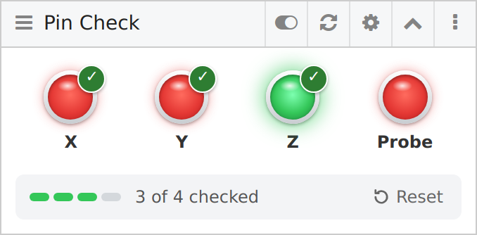
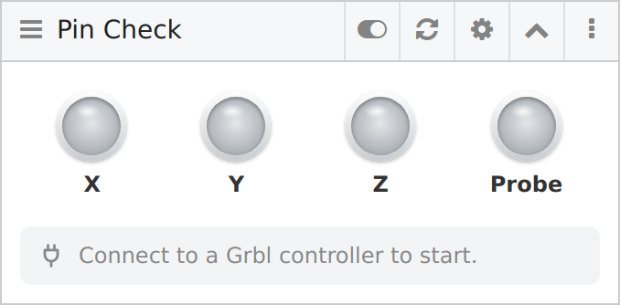
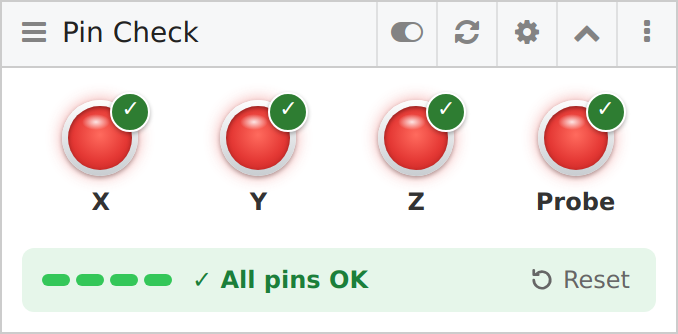

# Pin Check — cncjs widget



Four indicators (X, Y, Z, Probe) for a quick pre-run check: red by default,
green while a limit switch is pressed or the probe is closed. Grey when no
Grbl controller is connected.

Each pin that has worked gets a check mark that stays, and the widget shows
**✓ All pins OK** once all four are checked — no need to watch the screen
while you walk around the machine.

Works with stock cncjs, no rebuild needed: it is a plain static page
(no build step, no dependencies) loaded by the built-in **Custom Widget**.
Grbl only — other controllers do not report input pin states.

**Requires cncjs 1.11.5 or newer.** Older versions never fill in the pin
state (fixed in [cncjs#1013](https://github.com/cncjs/cncjs/pull/1013)), so the indicators would stay red.

| Not connected | Checking | Ready to run |
| --- | --- | --- |
|  |  |  |

## Install

1. Copy this folder to the machine running cncjs, e.g. `~/cncjs-pincheck-widget`.

2. Mount it into cncjs — either on the command line:

   ```
   cncjs --mount /widget/pincheck:~/cncjs-pincheck-widget
   ```

   or permanently in `~/.cncrc`:

   ```json
   "mountPoints": [
     { "route": "/widget/pincheck", "target": "/home/pi/cncjs-pincheck-widget" }
   ]
   ```

   Restart cncjs after changing `~/.cncrc`.

3. In the cncjs workspace: **Manage Widgets** → enable **Custom Widget**
   (or use *Fork Widget* on an existing one to get another copy).

4. In the Custom Widget click the **gear icon (Edit)**, set the URL to
   `/widget/pincheck/` and, optionally, the title to `Pin Check`.

## Pre-run check

1. Connect to the machine — all four indicators turn red, `0 of 4 checked`.
2. Press each limit switch by hand and touch the probe to the touch plate.
   Each indicator lights green while pressed and keeps a ✓ afterwards.
3. When it says **✓ All pins OK**, you are good to go.

A pin is checked only after it has been seen *released and then triggered*,
so a switch that is stuck on (or wired NC without inversion) never passes.
**Reset** clears the check marks; reconnecting to the machine does too.

## How it works

Grbl 1.1 reports triggered inputs as `Pn:XYZP` in each status report, which
cncjs exposes as `controller.state.status.pinState`. cncjs polls the status
every 250 ms, so hold a switch a moment rather than just tapping it.

The widget only joins the port the workspace already has open; it never
opens or closes the machine port on its own.

## Notes

- With hard limits enabled (`$21=1`) pressing a limit switch puts Grbl into
  ALARM; unlock with `$X` afterwards, or test with `$21=0`.
- If an indicator is green at rest, the switch is normally-closed and the
  pin is not inverted — check `$5` (limits) and `$6` (probe).

## Testing without a machine

`tools/fake_grbl.py` is a tiny Grbl 1.1 emulator on a virtual serial port
(Linux / WSL, Python 3, no dependencies):

```
python3 tools/fake_grbl.py          # keys: x y z p toggle a pin, c clear, q quit
python3 tools/fake_grbl.py --demo   # cycles the pins by itself
```

It creates `~/fake-grbl-tty`. cncjs does not list virtual ports, so add it to
`~/.cncrc` (use your own home path) and restart cncjs:

```json
"ports": [
  { "path": "/home/you/fake-grbl-tty", "manufacturer": "Fake Grbl" }
]
```

Then open that port in the Connection widget (Grbl, 115200).

cncjs does not notice when the emulator exits, so press **Close** in the
Connection widget before restarting the emulator.

## Project layout

```
index.html          markup
css/style.css       styles
js/pincheck.js      widget logic
tools/fake_grbl.py  Grbl emulator for testing
screenshots/        images for this README
```

## License

[MIT](LICENSE)
